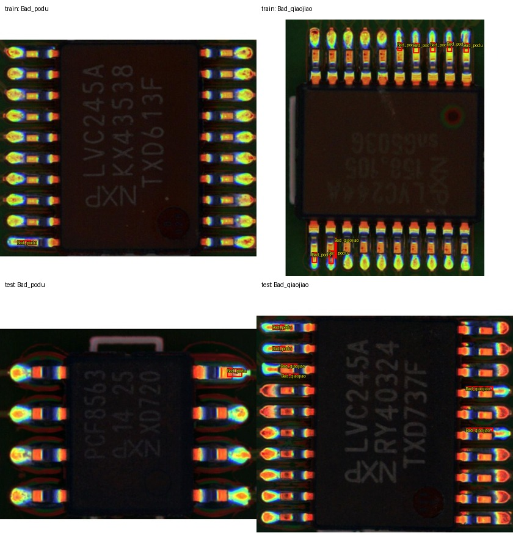
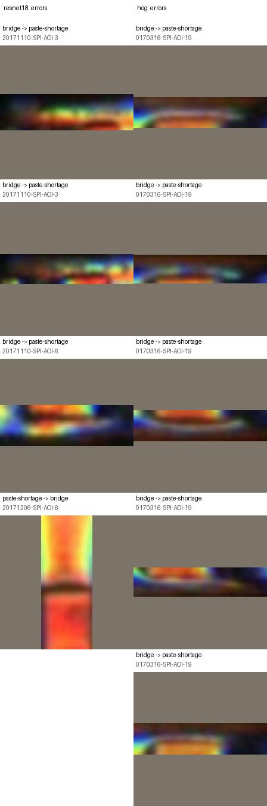

# PCB-AoI kart ayrımlı ROI sınıflandırma ön deneyi

29 Ekim 2026. Bu, SolDef_AI ve VisA sonuçlarından ayrı bir veri kümesinde yürütülen dış kart testi pilotudur. Veri kümesi lehim pastası denetimi (SPI) aşamasındadır; SolDef_AI'daki lehim bağlantısı incelemesiyle aynı üretim aşaması veya görev değildir.

## Veri erişimi ve denetim

Kaynak [KubeEdge-Ianvs PCB-AoI veri sayfası](https://ianvs.readthedocs.io/en/latest/proposals/scenarios/industrial-defect-detection/pcb-aoi.html) ve [Kaggle dağıtımı](https://www.kaggle.com/datasets/kubeedgeianvs/pcb-aoi). Kaggle API metaverisi Apache 2.0 lisansı, 5. sürüm ve 106.961.567 baytlık açılmış içerik bildiriyor. İndirilen ZIP 103.054.569 bayt; SHA256: `e41ff47069070de284ed11c73db15d9b442da8fb9cafa08da110878c43759da2`.

| Bölüm | Görüntü | ROI anotasyonu | Kusur ROI sayısı |
|---|---:|---:|---:|
| Resmî ham eğitim | 173 | 173/173 eşleşti | 679 |
| Resmî test | 60 | 60/60 eşleşti | 332 |
| Eğitim artırmaları | 1.211 | 1.211/1.211 eşleşti | 4.753 |

Resmî açıklama bölmeyi 173 eğitim kartı ve 60 test kartı olarak tanımlıyor; eğitim artırmalarını bağımsız örnek saymadık. Ham eğitimde SHA256 ile belirlenen iki birebir görüntü tekrarı vardı. Her tekrarda anotasyon XML'i en fazla ROI içeren dosyadan deterministik seçildi; ham eğitim böylece 171 tekil görüntüye ve 674 ROI'ye indi. Testte 60 tekil görüntü kaldı; eğitim-test arasında birebir görüntü kopyası bulunmadı.

600×600 görüntüler ve Pascal VOC XML kutuları incelendi: eksik dosya, boyut uyuşmazlığı veya sınır dışı/geçersiz kutu yok. Sabit örnek görselinde kutular lehim/pad bölgelerine hizalı görünüyor; bu inceleme tüm anotasyonların uzman onayı değildir.



Testte yalnızca kusurlu ROI'ler bulunuyor: `Bad_podu` 295, `Bad_qiaojiao` 37. Eğitimde tekrarlar çıkarıldıktan sonra sırasıyla 531 ve 143 ROI var. Bu dağılım nedeniyle sıradan doğruluk yanıltıcı olabilir; dengeli doğruluk, makro F1 ve sınıf geri çağırımı esas alınmalı.

## Önceden sabitlenen karşılaştırma

Görev, **doğru anotasyon kutusu verilmişken kusur türünü sınıflandırmaktır**. Kutu bulma modeli ölçülmüyor. Ham eğitim görüntülerinden 20% bağlamlı ROI alınır; en-boy oranı korunup 224×224'e doldurulur. İki donmuş temsil aynı ROI'lerde kullanılır:

- ImageNet-1K V1 ağırlıklı 512 boyutlu ResNet18 özelliği; kosinüs en yakın sınıf merkezi.
- 9 bölmeli HOG; 16 piksel hücre ve 2×2 hücre L2-Hys blokları; kosinüs en yakın sınıf merkezi.
- Eğitimde çoğunluk sınıfı başlangıç çizgisi.

Ön işleme ve sınıf-merkezi yöntemi önceki SolDef ROI pilotunda kullanılan sabit protokolden alındı; bu test kümesine bakarak ayar yapılmadı. Test belirsizliği 60 görüntü/kart grubu üzerinden 2.000 örnekli bootstrap ile hesaplandı. Resmî testte normal örnek bulunmadığından yanlış alarm oranı, PatchCore veya tek-sınıf anomali başarımı hesaplanamaz.

## Sonuçlar

| Yöntem | Doğruluk | Dengeli doğruluk | Makro F1 | `Bad_podu` geri çağırımı | `Bad_qiaojiao` geri çağırımı |
|---|---:|---:|---:|---:|---:|
| ResNet18 | %98,80 | %95,78 | %96,88 | %99,66 | %91,89 |
| HOG | %88,86 | %63,00 | %65,59 | %96,27 | %29,73 |
| Çoğunluk sınıfı | %88,86 | %50,00 | %47,05 | %100,00 | %0,00 |

ResNet18 toplam 332 test ROI'sinin 328'ini, HOG 295'ini doğru sınıflandırdı. HOG'un doğruluğu çoğunluk kontrolüyle aynı olsa da ikinci kusur sınıfının yalnızca 11/37 örneğini yakaladı; dengeli ölçümler bu farkı görünür kılıyor.

| Eşleştirilmiş fark (ResNet18 − HOG) | Ortalama fark | Kart-grubu bootstrap %95 aralığı |
|---|---:|---:|
| Dengeli doğruluk | +32,96 yüzde puan | +18,94 ila +45,78 |
| Makro F1 | +32,23 yüzde puan | +18,41 ila +47,05 |

ResNet18'in tek başına kart-grubu bootstrap %95 aralığı dengeli doğrulukta %90,16–%100,00, makro F1'de %92,70–%100,00. Test yalnızca 60 kart ve 37 `Bad_qiaojiao` ROI içerdiğinden belirsizlik hâlâ kayda değer. Bunlar bağımsız ROI bootstrap'ı değil, görüntü/kart grubu örneklemesidir.



Makinece okunabilir sonuç ve tüm tekrar üretim metaverisi: [sınıflandırma JSON raporu](../reports/pcb-aoi-classifier-v1.json), [veri denetimi JSON raporu](../reports/pcb-aoi-data-audit-v1.json). Yerel tam tahminler ve manifest, veri indirmesi gibi Git dışındaki `data/` klasöründe tutulur.

## Yorum ve sınırlar

Bu sonuç, PCB-AoI'nin iki etiketli kusur ROI'sinde donmuş ResNet18 özelliklerinin HOG'dan daha ayırt edici olduğunu gösteren, resmî kart dışarıda testinde yapılmış bir **kusur türü sınıflandırma** kanıtıdır. Sınıf dengesi basit doğruluğu özellikle yanıltıyor.

Sonuç nesne tespit başarımı, kusur lokalizasyonu, normal-kusurlu ayrımı veya üretim yanlış alarm oranı değildir. Testte normal örnek yoktur ve kusur kutuları modele önceden verilmiştir. SolDef_AI'daki etiketli komponent/lehim ROI görevi ve VisA'daki görüntü düzeyi PatchCore göreviyle aynı ölçüm olarak birleştirilemez. PCB-AoI lehim pastasının basım sonrası denetimidir; post-reflow lehim bağlantısının doğrulanması değildir.

## Yeniden üretim

```console
python -m pcb_anomaly.pcb_aoi audit --root data/pcb-aoi --archive data/downloads/PCB-AoI.zip --output data/pcb-aoi-audit-v1
python -m pcb_anomaly.pcb_aoi_classifier --archive data/downloads/PCB-AoI.zip --audit-manifest data/pcb-aoi-audit-v1/manifest.jsonl --output data/pcb-aoi-classifier-v1 --cache data/torch-cache
```

Çıktı klasörleri yeni olmalı. Eğitim artırması sınıflandırma deneyinde kullanılmaz; yalnızca ham resmî eğitim/test bölümleri kullanılır.
