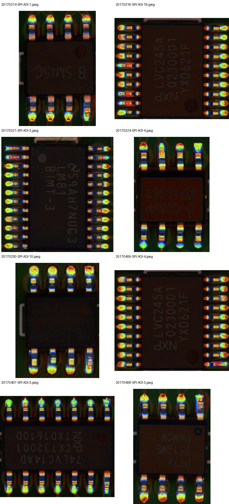

# PCB-AoI tam kutu tespit denemesi

29 Ekim 2026. Bu çalışma, aynı PCB-AoI kaynağındaki ROI kusur türü sınıflandırmasını tam görüntüde kutu tespitiyle karşılaştırmak için yapıldı. Sonuçlar VisA PatchCore veya SolDef_AI ROI sınıflandırma metrikleriyle birleştirilmemelidir.

## Önceden belirlenen düzen

- Resmî 60 test kartı son değerlendirme için ayrıldı. 173 ham eğitim görüntüsündeki iki birebir tekrar çıkarılınca 171 görüntü kaldı; bunların 136'sı model eğitimine, 35'i epoch seçimi için doğrulamaya ayrıldı (seed 42). Eğitim artırım görüntüleri kullanılmadı.
- COCO ağırlıklarıyla başlatılmış torchvision Faster R-CNN MobileNetV3-Large FPN 320 modeli 10 epoch eğitildi. SGD, batch 2, başlangıç öğrenme oranı 0,0025, momentum 0,9, weight decay 0,0005; 5. epoch sonrası öğrenme oranı 0,1 ile çarpıldı.
- En iyi checkpoint, yalnızca eğitim içi doğrulamada en yüksek mAP@0.5:0.95 değerine göre seçildi; eşitlikte erken epoch tercih edildi. Test kutuları veya skorlarıyla ayar seçilmedi.
- AP her sınıf için 101 noktalı enterpolasyonla, IoU 0,50–0,95 (0,05 aralıklarla) kullanılarak hesaplandı.

Çoğu anotasyon kutusu küçük: ham eğitimde medyan genişlik 17 px, yükseklik 15 px. 320 piksel model girişi bu hedefleri daha da küçültür. Bu koşul standart COCO başlangıç ağırlıklı bir detector pilotudur; PCB'ye özel küçük nesne anchor'ları ayarlanmadı.

## Sonuç

Doğrulama mAP@0.5:0.95 en yüksek değerine 9. epoch'ta ulaştı: **%0,41**. Seçilen checkpoint'in dokunulmamış resmî test ölçümleri:

| Ölçüm | Değer |
|---|---:|
| mAP@0.5 | %1,77 |
| mAP@0.5:0.95 | %0,38 |
| `Bad_podu` AP@0.5 | %2,45 |
| `Bad_qiaojiao` AP@0.5 | %1,09 |
| Test kartı / anotasyon kutusu | 60 / 332 |



Makinece okunabilir sonuçlar, eğitim geçmişi ve protokol: [sonuç JSON'u](../reports/pcb-aoi-detector-v1.json), [epoch geçmişi](../reports/pcb-aoi-detector-training-v1.json). Model ağırlıkları, ham tahminler ve arşiv `data/` altında yerel kalır.

## Yorum

Bu belirli detector başlangıç ayarı, PCB-AoI'deki kusurları tam görüntüden güvenilir biçimde bulamadı. Önceki ROI deneyi kusur kutularını modele verdiği için tür sınıflandırmasında %95,78 dengeli doğruluğa ulaşmıştı; mevcut mAP sonucu, bu başarıyı kutu bulma görevine genelleyemediğimizi gösteriyor.

Test kümesinde normal görüntü yok; dolayısıyla normal kartlarda yanlış alarm oranı ölçülemez. Düşük mAP detector'un her olası mimari/ayar altında başarısız olacağını kanıtlamaz. Olası teknik darboğazlar küçük hedefler, 320 giriş çözünürlüğü ve COCO anchor ölçekleridir. Bunlar yalnızca eğitim içi doğrulama ile incelenebilir. Resmî 60 kart artık görülen test kümesi olduğundan, model/anchor/çözünürlük ayarlamaları için tekrar kullanılmamalı; sonraki doğrulayıcı iddia yeni, önceden ayrılmış kart verisi gerektirir.

Bu sonuç makale taslağında **başarısız tam detector başlangıç deneyi** olarak raporlanabilir; yüksek ROI sınıflandırma sonucunun yerine geçmez ve otomatik üretim denetimi iddiasını desteklemez.

## Eğitim içi küçük-kutu denemesi (test kullanılmadı)

320 px başlangıç ayarındaki düşük doğrulama sonucunu incelemek için, aynı 137/34 eğitim/doğrulama kartı bölmesinde yalnızca girdi boyutu ve RPN anchor ölçeği değiştirildi. COCO başlangıçlı aynı Faster R-CNN MobileNetV3-Large kullanıldı; giriş 640 px yapıldı ve üç FPN seviyesinde sırasıyla 8/16/32 px anchor ölçekleri (her seviyede 0,5/1/2 oranları) kullanıldı. Eğitim 10 epoch sürdü ve en iyi checkpoint doğrulama mAP@0.5:0.95 ile seçildi. Resmî 60 kartlık test değerlendirilmedi.

| Eğitim içi ölçüm | 320 px varsayılan anchor | 640 px küçük anchor |
|---|---:|---:|
| En iyi doğrulama mAP@0.5 | %1,23 | %0,37 |
| En iyi doğrulama mAP@0.5:0.95 | %0,4104 | %0,0523 |
| Seçilen epoch | 9 | 4 |
| Süre (CPU) | yaklaşık 398 sn | yaklaşık 1.200 sn |

Bu keşif denemesi küçük anchor ve daha yüksek çözünürlüğün birlikte fayda sağladığını göstermedi; mAP@0.5:0.95 aynı doğrulama bölmesinde daha da düştü. Bu, tek seed ve küçük doğrulama bölmesiyle sınırlı bir **ayar bulgusudur**, bağımsız test sonucu değildir. İki değişkeni birbirinden ayıran bir faktöriyel tarama yapılmadı. Deney sonrası görülen doğrulamaya göre ek ayar seçimi yapılmamalı; ana sonuç ve yeni bir model iddiası için yeni, dokunulmamış kartlar gerekir.

Yeniden üretim (eğitim içi doğrulama dışında ölçüm üretmez):

```console
python -m pcb_anomaly.pcb_aoi_detector --archive data/downloads/PCB-AoI.zip --audit-manifest data/pcb-aoi-audit-v2/manifest.jsonl --output data/pcb-aoi-detector-small-v1 --cache data/torch-cache --epochs 10 --threads 4 --min-size 640 --small-anchors --validation-only
```

Eğitim geçmişi ve makinece okunabilir sonuç: [validation JSON](../reports/pcb-aoi-detector-small-validation-v1.json). Yerel checkpoint depoya eklenmez.

## Yeniden üretim

```console
python -m pcb_anomaly.pcb_aoi_detector --archive data/downloads/PCB-AoI.zip --audit-manifest data/pcb-aoi-audit-v2/manifest.jsonl --output data/pcb-aoi-detector-v1 --cache data/torch-cache --epochs 10 --threads 4
```

Deney CPU'da yaklaşık 398 saniye sürdü. PyTorch/Torchvision COCO ağırlıkları ilk çalıştırmada indirilir. Çıktı klasörü önceden bulunmamalıdır.
