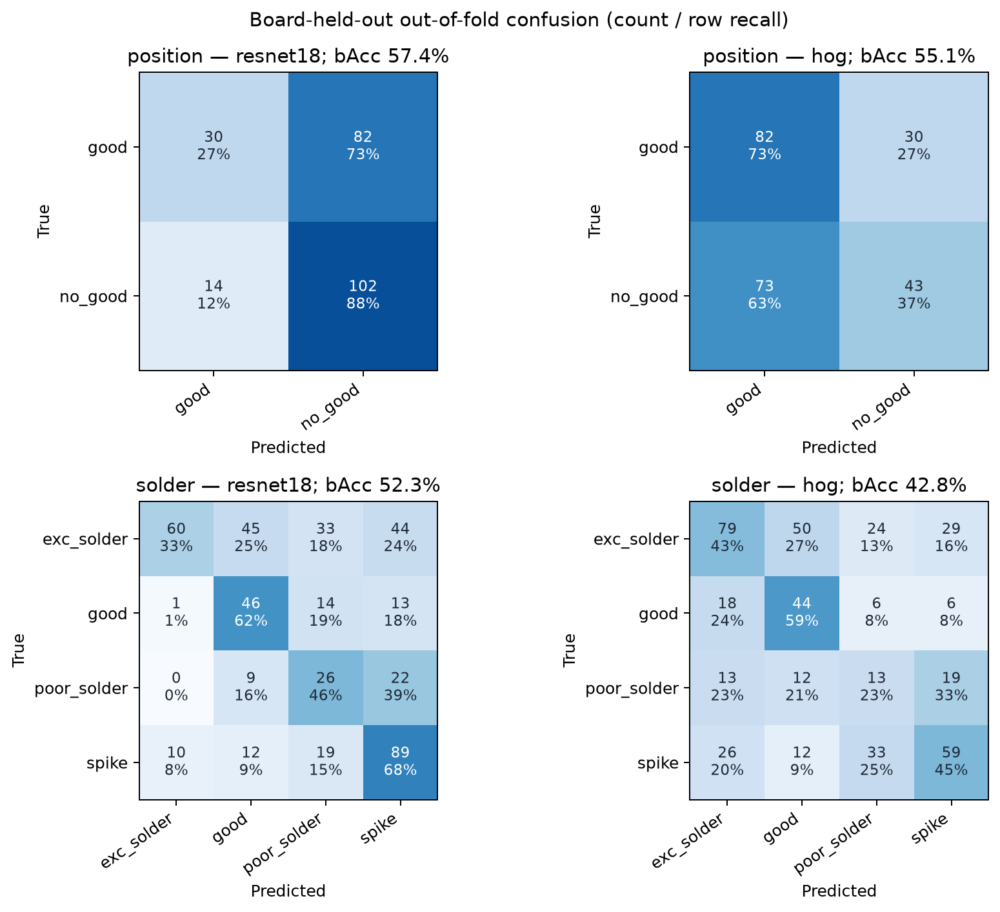
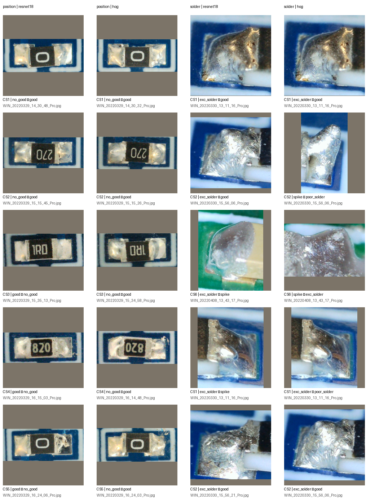

# SolDef_AI kart ayrımlı ResNet18 ve HOG ilk sonuçları

## Sonuç

İki sabit özellik çıkarıcı aynı anotasyon poligonundan, %20 bağlam paylı ve 224×224'e oranı korunarak yerleştirilmiş kırpımı kullanıyor. ImageNet-1K V1 ResNet18 dondurularak 512 boyutlu özellik üretiyor. Klasik karşılaştırma 9 yönelim bölmeli HOG kullanıyor (16 px hücre; 2×2 hücre L2-Hys blokları). Her fold'da eğitim kartlarının sınıf merkezleri alınıyor ve test poligonları kosinüs benzerliğiyle atanıyor. Parametre ayarı yapılmadı.

| Görev | Dış test poligonu | ResNet18: dengeli doğruluk / makro F1 | HOG: dengeli doğruluk / makro F1 | Çoğunluk kontrolü: dengeli doğruluk / makro F1 |
|---|---:|---:|---:|---:|
| Komponent konumu (`good` / `no_good`) | 228 | %57,4 / %53,2 | %55,1 / %53,5 | %42,6 / %40,6 |
| Lehim (`good`, `exc_solder`, `poor_solder`, `spike`) | 443 | %52,3 / %47,9 | %42,8 / %40,9 | %17,9 / %14,8 |

Tablodaki pooled değerler, her kaynak PCB'yi sırayla dışarıda bırakan fold'ların tüm dış test tahminlerini birleştirir.

Yöntemler farklı hata dengelerine sahip. Konumda ResNet18 `no_good` örneklerini daha iyi yakalıyor (%87,9'a karşı HOG %37,1); HOG `good` örneklerinde daha iyi (%73,2'ye karşı %26,8). Konum makro F1'i neredeyse aynı (%53,2 / %53,5), dengeli doğruluk ResNet18'de 2,3 puan yüksek. Lehimde ResNet18 dengeli doğrulukta HOG'u 9,5 puan, makro F1'de 7,0 puan geçiyor. ResNet18'in lehim sınıf yakalama oranları `exc_solder` %33,0, `good` %62,2, `poor_solder` %45,6 ve `spike` %68,5; HOG'da sırasıyla %43,4, %59,5, %22,8 ve %45,4.

Kartlar arasındaki fold dengeli doğruluk ortalaması ResNet18/HOG için konumda %60,4 ± 5,9 / %60,6 ± 6,8; lehimde %55,6 ± 9,0 / %43,3 ± 6,1. Bu sapmalar az sayıda kart arasındaki betimsel değişkenliktir, güven aralığı değildir. En düşük ResNet18 fold'u konumda CS6 (%50,0), lehimde CS1 (%45,3).





Makinece okunabilir metrikler, fold sonuçları, model ağırlık SHA256'sı ve veri/protokol özetleri: [JSON raporu](../reports/soldef-resnet18-v1.json). Sayılar ROI poligon sınıflandırması içindir; görüntü düzeyi arıza bulma, piksel lokalizasyonu veya VisA PatchCore sonuçlarıyla aynı ölçüm değildir.

## Yeniden üretme

Önce [kart bazlı split manifestini](soldef-board-splits.tr.md) ve yerel SolDef arşivini hazırlayın. Sonra yeni bir çıktı dizini kullanın:

```console
python -m pcb_anomaly.soldef_resnet --split-manifest data/soldef-board-splits-v1/manifest.jsonl --archive data/soldef-ai/archive.zip --output data/soldef-resnet18-new
```

Özellik çıkarımı önbellekteki ResNet18 ImageNet-1K V1 ağırlığını kullanır. Her kaynak görüntüden anotasyon poligonlarının etrafındaki bağlamlı kutu kırpılır; test PCB'si yalnızca tahmin aşamasında kullanılır. Eğitim kartlarının sınıf merkezleri her fold için baştan hesaplanır. Test fold'ları tümüyle raporlandığından, bu sonuçları gördükten sonra seçilecek yöntem için yeni bir bağımsız test gerekir.

## Yorum ve sınırlar

İki özellik çıkarıcı da çoğunluk sınıfı kontrolünü geçti, ancak sonuçlar güçlü değil. HOG, konum görevinde HOG/ResNet18 kararlarının basitçe birleştirilmesi için gerekçe sunan sınıf dengesi farkı gösteriyor; bu fold'larda birleşim denemek test verisiyle yöntem seçmek olur. Lehim görevi üç kartla sınırlı ve sınıf sayıları dengesiz. Sınıf başına F1 ve confusion matrix birlikte okunmalı.

Bu deney, makaledeki poligon anotasyonlarıyla denetimli ROI sınıflandırmasıdır. Etiketsiz görüntüler normal sayılmadı; AnomalyDINO/PatchCore eşdeğeri bir anomali deneyi yapılmadı. Altı/üç kartlı çapraz doğrulama yayın düzeyinde bağımsız son doğrulama değildir. Bütün kart fold'ları bu karşılaştırmada kullanıldı; şimdi yöntem birleştirme veya HOG ayarı yapmadan önce yeni PCB görüntüleri gerekir. Hatalı crop galerisi sabit sıralı hata örnekleridir, bütün hata türlerinin temsili örneklemi değildir.
