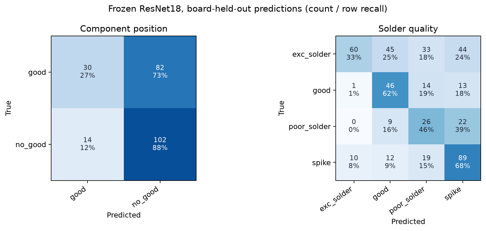

# SolDef_AI kart ayrımlı ResNet18 ilk sonuçları

## Sonuç

İlk sabit baseline, anotasyon poligonlarının çevresinden %20 bağlam paylı kırpım alıyor; kırpım 224×224'e oranı korunarak yerleştiriliyor. ImageNet-1K V1 ile önceden eğitilmiş ResNet18 donduruluyor. 512 boyutlu özellikler L2 normalize ediliyor; her fold'daki eğitim kartlarından sınıf merkezleri hesaplanıp test poligonları kosinüs benzerliğiyle sınıflandırılıyor. Omurga eğitilmedi ve parametre ayarı yapılmadı.

| Görev | Dış test poligonu | ResNet18 dengeli doğruluk | Makro F1 | Eğitim çoğunluk sınıfı kontrolü: dengeli doğruluk / makro F1 |
|---|---:|---:|---:|---:|
| Komponent konumu (`good` / `no_good`) | 228 | %57,4 | %53,2 | %42,6 / %40,6 |
| Lehim (`good`, `exc_solder`, `poor_solder`, `spike`) | 443 | %52,3 | %47,9 | %17,9 / %14,8 |

Sonuçlar, her kaynak PCB'yi sırayla dışarıda bırakan fold'ların tüm dış test tahminlerini birleştirir. Fold dengeli doğruluk ortalaması konum görevinde %60,4 ± 5,9; lehimde %55,6 ± 9,0. Bu sapma yalnızca altı/üç PCB arasındaki betimsel değişkenliktir; güven aralığı değildir.

Modelin sınıf davranışı dengeli değil. Konumda `no_good` yakalama oranı %87,9 iken `good` yakalama %26,8. Lehimde sınıf yakalama oranları `exc_solder` %33,0, `good` %62,2, `poor_solder` %45,6 ve `spike` %68,5. Konumda en düşük fold CS6'da dengeli doğruluk %50; lehimde CS1 dışarıda bırakıldığında %45,3. Kart farkı sonraki hata incelemesinde öncelikli.



Makinece okunabilir metrikler, fold sonuçları, model ağırlık SHA256'sı ve veri/protokol özetleri: [JSON raporu](../reports/soldef-resnet18-v1.json). Sayılar ROI poligon sınıflandırması içindir; görüntü düzeyi arıza bulma, piksel lokalizasyonu veya VisA PatchCore sonuçlarıyla aynı ölçüm değildir.

## Yeniden üretme

Önce [kart bazlı split manifestini](soldef-board-splits.tr.md) ve yerel SolDef arşivini hazırlayın. Sonra yeni bir çıktı dizini kullanın:

```console
python -m pcb_anomaly.soldef_resnet --split-manifest data/soldef-board-splits-v1/manifest.jsonl --archive data/soldef-ai/archive.zip --output data/soldef-resnet18-new
```

Özellik çıkarımı önbellekteki ResNet18 ImageNet-1K V1 ağırlığını kullanır. Her kaynak görüntüden anotasyon poligonlarının etrafındaki bağlamlı kutu kırpılır; test PCB'si yalnızca tahmin aşamasında kullanılır. Eğitim kartlarının sınıf merkezleri her fold için baştan hesaplanır. Test fold'ları tümüyle raporlandığından, bu sonuçları gördükten sonra seçilecek yöntem için yeni bir bağımsız test gerekir.

## Yorum ve sınırlar

ResNet18 kontrolü, görevlerin öğrenilebilir bir görsel sinyal taşıdığına dair ilk pozitif işaret veriyor; fakat sonuçlar kuvvetli değil. Özellikle konum sınıflandırıcısı iyi lehimlenmiş örnekleri `no_good` diye fazla işaretliyor. Lehim görevi üç kartla sınırlı ve sınıf sayıları dengesiz. Sınıf başına F1 ve confusion matrix birlikte okunmalı.

Bu deney, makaledeki poligon anotasyonlarıyla denetimli ROI sınıflandırmasıdır. Etiketsiz görüntüler normal sayılmadı; AnomalyDINO/PatchCore eşdeğeri bir anomali deneyi yapılmadı. Kırpım ve embedding yöntemi önceden sabitlenmiş olsa da bu küçük çapraz doğrulama yayın düzeyinde bağımsız doğrulama değildir. Sonraki adım fold bazında confusion örneklerini görsel incelemek ve ardından aynı sabit fold'larda HOG gibi basit bir klasik baseline ile/veya doğrusal ResNet başlığıyla karşılaştırmaktır. Yöntem seçimi sonrası ayrıca görülmemiş PCB gerekir.
