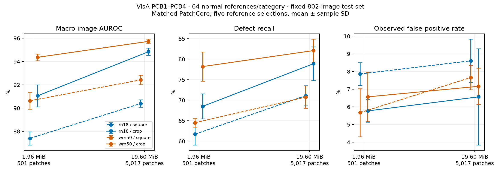
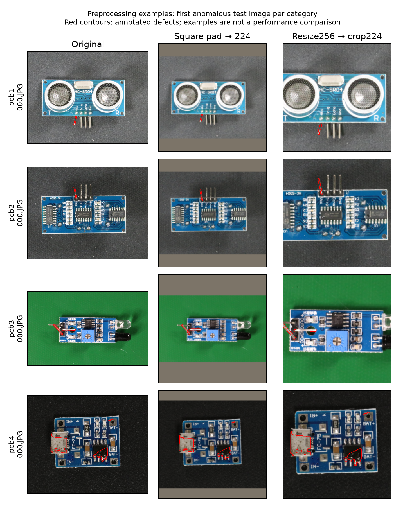

# Ortak ön işleme ve eşit yama belleğiyle PatchCore karşılaştırması

## Sonuç

**Önceki 8,24 puanlık AUROC farkı yalnızca omurgadan gelmiyor.** Aynı merkez kırpma, aynı resmî PatchCore uygulaması ve aynı 19,60 MiB yama belleğinde ResNet18 %94,84, WideResNet50-2 %95,73 AUROC elde etti. Eşlenmiş fark **0,89 ± 0,28 yüzde puan**; beş seed'deki farklar 0,47–1,23 puan aralığında. Bu sapma yeni test görüntülerine genelleme güven aralığı değildir.

Küçük bankada WideResNet50'nin avantajı daha büyük: aynı merkez kırpma ve 1,96 MiB ile **3,31 ± 1,13 puan**. Dolayısıyla sonuç “omurga önemsiz” değil; omurga avantajı ön işleme ve bellek bütçesine bağlı.

| Omurga | Ön işleme | Yama bankası MiB | AUROC (%) | AP (%) | Kusur yakalama (%) | Yanlış alarm (%) |
|---|---|---:|---:|---:|---:|---:|
| ResNet18 | square | 1,957 | 87,40 ± 0,57 | 87,95 ± 0,58 | 61,70 ± 2,64 | 7,86 ± 0,65 |
| ResNet18 | square | 19,598 | 90,39 ± 0,32 | 90,28 ± 0,38 | 71,10 ± 2,43 | 8,61 ± 1,23 |
| ResNet18 | crop | 1,957 | 91,06 ± 0,95 | 91,88 ± 1,03 | 68,50 ± 3,05 | 5,77 ± 0,64 |
| ResNet18 | crop | 19,598 | 94,84 ± 0,31 | 94,80 ± 0,25 | 78,90 ± 4,13 | 6,57 ± 2,73 |
| WideResNet50-2 | square | 1,957 | 90,63 ± 0,73 | 91,26 ± 0,64 | 64,50 ± 1,05 | 5,67 ± 1,36 |
| WideResNet50-2 | square | 19,598 | 92,42 ± 0,41 | 92,42 ± 0,26 | 70,75 ± 2,74 | 7,66 ± 0,69 |
| WideResNet50-2 | crop | 1,957 | 94,36 ± 0,29 | 94,84 ± 0,35 | 78,20 ± 3,59 | 6,57 ± 1,38 |
| WideResNet50-2 | crop | 19,598 | 95,73 ± 0,19 | 95,84 ± 0,25 | 82,10 ± 2,79 | 7,16 ± 1,03 |

Ortalamalar ± beş referans seçimi arasındaki örnek standart sapması. `square`: kareye doldurup 224'e küçültme; `crop`: kısa kenar 256, merkez kırpma 224. Aynı kalibrasyon kuralı uygulanır; gözlenen test yanlış alarm oranları eşit değildir.



[Vektörel grafik](figures/visa-controlled.pdf) · [Makinece okunabilir sonuçlar, eşlenmiş farklar ve doğrulama](../reports/visa-controlled-v1.json)

## Önceki kazanım nereden geliyor?

Aşağıdaki sıralı geçiş, eski %87,49'dan %95,73'e giden bir açıklama yoludur:

| Geçiş | AUROC değişimi (yüzde puan, eşlenmiş ortalama ± SS) |
|---|---:|
| Eski ResNet18 varyantı → resmî ortak uygulama; square, 501 yama | −0,09 ± 0,78 |
| ResNet18 square: 501 → 5.017 yama | +2,99 ± 0,75 |
| ResNet18 büyük banka: square → crop | +4,45 ± 0,42 |
| Crop ve büyük banka: ResNet18 → WideResNet50-2 | +0,89 ± 0,28 |

İlk geçiş özellik boyutu, birleştirme ve örnekleme gibi değişiklikleri birlikte kapsar; saf bir uygulama etkisi değildir. Diğer üç geçiş ortak uygulamada tek faktörü değiştirir. **Bu sıralama tek ve benzersiz bir nedensel paylaştırma değildir.** Önce crop'a geçilirse ResNet18'de ön işleme +3,66, sonra bellek +3,78 puan getirir. Ön işleme ile bellek etkileşimi bu nedenle göz ardı edilemez.

Omurga farkı ayrıca her iki ön işlemede ve her iki bütçede doğrudan ölçüldü:

| Ön işleme | Banka MiB | WRN − RN AUROC farkı (yüzde puan) |
|---|---:|---:|
| square | 1,96 | +3,23 ± 1,06 |
| square | 19,60 | +2,03 ± 0,51 |
| crop | 1,96 | +3,31 ± 1,13 |
| crop | 19,60 | +0,89 ± 0,28 |

Merkez kırpmada bellek artışı ResNet18'e +3,78, WideResNet50'ye +1,37 AUROC puanı getiriyor. WRN'nin omurga avantajı büyük bankada 2,42 puan daralıyor. Bu, küçük yama belleğinde WRN'nin daha yararlı olduğunu destekleyen betimsel bir sonuçtur; toplam RAM veya hız üstünlüğü değildir.

Büyük banka ve crop altında kusur yakalama WRN'de 3,20 puan daha yüksek, fakat yanlış alarm da 0,60 puan daha yüksek. Beş seed'in birinde WRN'nin kusur yakalaması RN'den 3 puan düşük; AUROC sıralamasındaki tutarlılık eşik sonrası kararlılık garantilemez.

## Kategori düzeyinde ortak crop ve 19,60 MiB

| Kategori | RN AUROC | WRN AUROC | RN kusur yakalama | WRN kusur yakalama | RN yanlış alarm | WRN yanlış alarm |
|---|---:|---:|---:|---:|---:|---:|
| PCB1 | 93,82 | 94,92 | 74,80 | 79,00 | 9,40 | 8,20 |
| PCB2 | 92,44 | 94,13 | 75,40 | 82,40 | 5,20 | 8,40 |
| PCB3 | 93,92 | 94,21 | 69,40 | 68,80 | 5,35 | 5,35 |
| PCB4 | 99,18 | 99,65 | 96,00 | 98,20 | 6,34 | 6,73 |

Değerler beş seed ortalaması ve yüzde cinsindendir; kategori sapmaları JSON çıktısında yer alır. PCB3'te daha büyük omurga kusur yakalamayı artırmıyor. Bu kategori hâlâ hata analizi ve kalibrasyon çalışması gerektiriyor.

## Proje açısından karar

ResNet18 + ortak PatchCore + crop + büyük banka güçlü ve daha az parametreli bir karşılaştırma tabanı olarak korunmalı. WRN + crop + küçük banka da düşük yama belleği seçeneği: %94,36 AUROC ve %78,20 yakalama ile RN'nin büyük bankalı %94,84 / %78,90 sonucuna yakın, ancak omurga daha büyük.

Makale iddiası “büyük omurga çok daha iyi” olmamalı. Bu deney, ön işleme ve bellek kontrol edilmeden yapılan karşılaştırmanın omurga kazancını abartabildiğini gösteriyor. Sonraki adım, önceden sabitlenmiş protokolle yanlış alarm kontrolünü ve çözünürlük/kadraj etkisini bağımsız doğrulamada incelemek; yalnızca yeni model eklemek henüz temel sorunu çözmüyor.

Kalibrasyon eşiklerini değiştirerek işletim noktasını ve kaçırılan kusurları incelediğimiz [devam analizi](visa-operating-points.tr.md) daha sonra tamamlandı. Aynı incelenmiş test verisinde büyük bankalı RN ile küçük bankalı WRN, %5 kalibrasyon hedefinde çok benzer yakalama/yanlış alarm dengesi veriyor. Büyük bankalı WRN daha çok kusur yakalıyor ama daha fazla normal görüntüde alarm veriyor. Küçük maskeli kusurlar ve PCB3 ek hata incelemesi gerektiriyor.

## Soru ve deney düzeni

Önceki [beş referans seçimi deneyinde](visa-five-seeds.tr.md) ResNet18 varyantı ile resmî WideResNet50 ayarı arasında ortalama 8,24 yüzde puan AUROC farkı vardı. Ancak omurga, ön işleme, özellik birleştirme, coreset örnekleyicisi ve yama belleği birlikte değişiyordu. Bu nedenle farkı yalnızca WideResNet50'ye atfetmek mümkün değildi.

Bu çalışma sonuçlar hesaplanmadan kaydedilmiş tam faktöriyel düzen kullanır:

- Omurga: ImageNet-1K V1 ResNet18 veya WideResNet50-2; ağırlıklar donmuş.
- Ön işleme: ortalama RGB ile kareye doldurma ve 224'e küçültme (`square`); veya kısa kenarı 256'ya getirip merkezden 224 kırpma (`crop`). Her ikisi bilinear ve ImageNet normalizasyonu kullanır.
- Yama belleği: 501 veya 5.017 adet 1.024 boyutlu float32 vektör. Omurgalar arasında aynı bütçede tam olarak aynı bayt sayısı: 2.052.096 / 20.549.632 bayt, yani 1,957 / 19,598 MiB.
- Beş referans seçimi: seed 42–46, her kategoride 64 normal referans; önceki seçimlerin birebir aynısı.
- Dört kategori: VisA PCB1–PCB4. Her koşuda aynı 400 normal kalibrasyon görüntüsü ve 802 test görüntüsü (400 kusurlu, 402 normal).

Toplam 160 kategori/seed/ayar sonucu. Önceki çalışmanın tam aynı WideResNet50–crop–5.017 koşulundaki 20 sonucu yeniden kullanılır; diğer 140 değerlendirme yenidir. Yeniden kullanılan sonuçlar bağımsız tekrar olarak sayılmaz.

## Ortak uygulama ve bütçenin anlamı

Her iki omurga [resmî PatchCore kaynağının](https://github.com/amazon-science/patchcore-inspection/tree/fcaa92f124fb1ad74a7acf56726decd4b27cbcad) aynı `PatchCore` sınıfıyla çalışır. Layer2/layer3, 3×3 yama, 1.024/1.024 ön birleştirme/son özellik boyutları, 128 boyutlu rastgele projeksiyonla yaklaşık greedy coreset, tek en yakın komşu ve maksimum yama uzaklığı ortaktır. Skor FAISS'in karesel L2 uzaklığıdır. Her görüntü 28×28=784 yama verir.

Örnekleyici seed'i bütün koşullarda 42'dir. Büyük banka resmî %10 coreset ile seçilir; küçük banka ilk 501 seçimdir. İteratif greedy seçimin ilk adımları nihai seçim sayısından bağımsızdır. Ayrı resmî örnekleyici çağrılarıyla önek eşitliği ayrıca kontrol edilir. Böylece bellek kontrastına ikinci bir rastgele seçim etkisi eklenmez.

Eşit bütçe **saklanan yama vektörlerini** kapsar. Omurga parametreleri, aktivasyonlar, geçici özellikler ve FAISS'in banka kopyası bu sayıya dahil değildir. Bu, eşit toplam RAM veya eşit çalışma süresi deneyi değildir. Önceki özel ResNet18 varyantının 384 boyutlu bankası 0,734 MiB idi; yeni 1.024 boyutlu küçük banka ile aynı bayt bütçesinde değildir.

Yüklenen tam torchvision ağlarında ResNet18 11.689.512, WideResNet50-2 68.883.240 parametre içerir; float32 parametre depolaması sırasıyla yaklaşık 44,59 ve 262,77 MiB'dır. Bunlar tamponları veya aktivasyonları içeren ölçülmüş tepe RAM değerleri değildir. Yama çıkarımı layer2/layer3'e dayanır; tam ağ sayımı kullanılmayan sonraki katmanları da içerir.

## Ölçüm ve yorumlama

Kategori başına eşik, yalnızca 100 normal kalibrasyon skorunun `higher` yöntemiyle %95 kantilidir; skor eşikten büyükse alarm verilir. Testten eşik veya hiperparametre seçilmez. Bu ortak kalibrasyon kuralı **eşit gözlenen test yanlış alarm oranı garantilemez**.

AUROC ve AP önce dört kategori üzerinden makro ortalanır. Kusur yakalama ve yanlış alarm oranı her seed için 400 kusurlu/402 normal görüntünün toplam sayılarından hesaplanır. Ardından beş seed'in ortalaması ve örnek standart sapması verilir. Standart sapmalar güven aralığı değildir; 802 görüntünün beş kez kullanılması 4.010 bağımsız test örneği oluşturmaz.

Omurga etkisi aynı ön işleme ve aynı bütçede WRN−RN; ön işleme etkisi aynı omurga/bütçede crop−square; bellek etkisi aynı omurga/ön işlemede büyük−küçük şeklinde eşlenmiş farklarla ölçülür. Etkiler ayara bağlı olabilir; tarihsel 8,24 puanlık farkın tek ve sıradan bağımsız bir toplamsal açıklaması varsayılmaz.

## Yeniden üretim

Önceki çalışmanın tamamlanmış yerel çıktıları ve veri/ağırlık önbelleği gereklidir:

```console
python -m pcb_anomaly.controlled plan
python -m pcb_anomaly.controlled run
python -m pcb_anomaly.controlled_report
```

Yeni çalışma için yeni `--output` kullanılır. Duran hesaplama aynı `run` komutuyla, atomik kaydedilmiş seed/bütçe sonuçlarından devam eder. Plan; veri manifesti, önceki referans planı, resmî kaynak, ağırlıklar ve çalıştırıcı kodunun SHA256 özetlerini tutar. Yeni bankaların seçilmiş indisleri, ham vektör SHA256 özetleri ve bütün skorlar yerelde saklanır; büyük geçici özellik önbellekleri kategori tamamlanınca kaldırılır. Yeni bankalar kaynaklar ve indislerden yeniden üretilebilir; önceki bankalar korunur.

Raporlayıcı 160 sonucun eksiksiz ve tekil olduğunu, sorgu/etiket eşleşmelerini, referans–sorgu ayrımını, eşik ve metrikleri, eşit banka baytlarını ve iç içe bankada uzaklıkların artmadığını denetler. Her koşulda ilk sorgu tam resmî `_predict` akışıyla da karşılaştırılır.

Tamamlanan doğrulama: **48 birim test**, **160/160 koşul**, **24.040 iç içe banka uzaklık kontrolü**. Her koşuldaki ilk sorgunun tam tahmin karşılaştırmasında maksimum mutlak fark **0**. Plan SHA256: `e0aca38c8ecc0b086969655dd89332e0099508c1344b5cbe59d40be688657c87`.

Koşu CPU üzerinde PyTorch/FAISS için dört iş parçacığı ve `OPENBLAS_NUM_THREADS=1` ile yapıldı. Kaydedilen süreler izole hız benchmarkı değildir. Yerel `execution-notes.json` çalışma koşullarını kaydeder. Özgün planın önceki çalışmadan devraldığı `scope` cümlesi tarihsel karşılaştırmayı anlatır; yeni deney `design/shared` alanlarıyla tanımlıdır. `plan-clarification.json` bu metinsel açıklamayı, plan veya sayısal ayarları değiştirmeden kaydeder.

## Sınırlar ve araştırma yönü

Bu çalışma daha önce incelenmiş VisA test setinde yapılan açıklayıcı bir ablation'dır; bağımsız son doğrulama değildir. Fiziksel kart kimliği ve yakın kopyalarla ayrım bağımsızlığı henüz gösterilmedi. Yalnızca görüntü düzeyi anomali tespiti ölçülür; piksel düzeyi kusur lokalizasyonu, üretim performansı ve yeni bir yöntem katkısı gösterilmez.

Omurga faktörü mimariyi ve ona ait ön eğitim ağırlıklarını birlikte kapsar; yalnızca derinlik veya parametre sayısı etkisi izole edilmez. Ortak 1.024 boyutlu temsil, uygulamayı ve banka baytlarını eşitlemek içindir; her omurga için en iyi boyut/sıkıştırma seçimi olduğu gösterilmemiştir. ResNet18'in 384 boyutlu varyantına aynı bayt bütçesinde daha fazla yama ayırmak ayrı bir verimlilik deneyidir.

Merkez kırpma, kusurun görünen alanını ve nesne ölçeğini birlikte değiştirebilir. Önceki maske denetiminde 400 kusurun tamamı kırpma sonrasında kısmen görünür kalırken 35 maskenin bir kısmı dışarıda kalmıştı. Bu nedenle ön işleme etkisi yalnızca bir yeniden boyutlandırma algoritması farkı olarak yorumlanmamalıdır.

Yeni geometrik denetim aşağıdaki değerleri verdi. Alanlar nearest-neighbor ile dönüştürülmüş ikili anotasyon maskelerinin piksel sayısıdır; lokalizasyon doğruluğu değildir. İki dönüşümde de tamamen kaybolan maske yoktur.

| Kategori | Medyan square kusur alanı | Medyan crop kusur alanı | Medyan doğrusal ölçek oranı | Kısmen kırpılan maske |
|---|---:|---:|---:|---:|
| PCB1 | 76 | 171 | 1,50 | 2/100 |
| PCB2 | 102 | 222,5 | 1,50 | 9/100 |
| PCB3 | 73 | 250 | 1,86 | 24/100 |
| PCB4 | 372,5 | 746,5 | 1,41 | 0/100 |



Her kategorinin dosya adına göre ilk kusurlu test görüntüsü; kırmızı konturlar gerçek anotasyonlardır. Örnek seçimi performansa dayanmaz. Görüntü kaynağı: Zou ve arkadaşları, VisA / SPot-the-Difference, ECCV 2022, [resmî veri deposu](https://github.com/amazon-science/spot-diff), [CC BY 4.0](https://creativecommons.org/licenses/by/4.0/). Bu şekilde yeniden boyutlandırma, doldurma, kırpma ve anotasyon konturları uygulanmıştır.

```console
python -m pcb_anomaly.preprocessing_review
```
