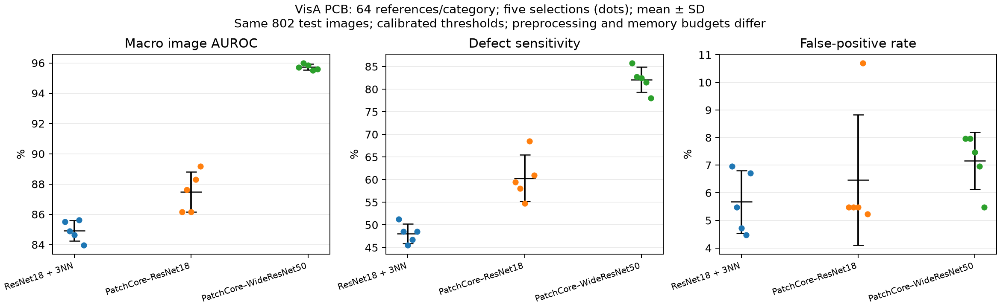

# VisA: beş referans seçimi ve resmî WideResNet50 PatchCore

17 Ekim 2026. Bu çalışma, ilk tek-seed karşılaştırmasını beş referans seçimine genişletir ve resmî PatchCore uygulamasının WideResNet50 ayarını ekler. Daha önce incelenmiş aynı benchmark üzerindeki bir genişletmedir; yeni, görülmemiş bir test kümesi değildir.

## Tamamlanan sonuçlar

Üç yöntem × beş referans seçimi × dört kategori = **60 değerlendirme** tamamlandı. Her koşuda aynı 802 test görüntüsü kullanıldı. Aşağıdaki değerler beş seçimde **ortalama ± örnek standart sapmadır**; AUROC/AP kategori ortalamalarıdır.

| Yöntem | AUROC (%) | AP (%) | Duyarlılık (%) | FPR (%) |
|---|---:|---:|---:|---:|
| ResNet18 + 3NN | 84.93 ± 0.68 | 85.70 ± 0.79 | 48.10 ± 2.17 | 5.67 ± 1.13 |
| PatchCore–ResNet18 | 87.49 ± 1.33 | 87.51 ± 0.97 | 60.35 ± 5.11 | 6.47 ± 2.37 |
| Resmî PatchCore–WideResNet50 | 95.73 ± 0.19 | 95.84 ± 0.25 | 82.10 ± 2.79 | 7.16 ± 1.03 |

Bu ayarlarda resmî WideResNet50 PatchCore, AUROC/AP ve kusur yakalamada öndedir. ResNet18 PatchCore varyantına göre ortalama AUROC **8,24 yüzde puan**, kusur yakalama **21,75 yüzde puan** artmıştır; gerçekleşen FPR de **0,70 yüzde puan** yükselmiştir. Eşit gerçekleşen FPR'deki duyarlılık kıyaslanmış değildir; aynı normal kalibrasyon kuralı kullanılmıştır.

Global ResNet18'e göre farklar AUROC'ta **10,80**, duyarlılıkta **34,00**, FPR'de **+1,49 yüzde puandır**. Ortalama yakalanan kusur sayısı 192,4 → 241,4 → 328,4/400; yanlış alarm sayısı 22,8 → 26,0 → 28,8/402'dir. Bunlar koşu ortalamalarıdır, tek bir değerlendirmede kesirli örnek sayısı değildir.

İlk tek-seed çalışmadaki “PatchCore–ResNet18 daha az yanlış alarm verdi” gözlemi beş seçim ortalamasında korunmadı. En iyi tek koşuyu seçmek bu ayrıntıyı gizlerdi. WideResNet50'nin AUROC standart sapması yalnızca 0,19 yüzde puandır; bu seçili referans örnekleminde sıralama kararlılığına işaret eder, genel saha kararlılığını kanıtlamaz.



Grafikte noktalar tek tek seçimleri, siyah işaretler ortalama ± standart sapmayı gösterir. [PDF sürümü](figures/visa-five-seeds.pdf). Makine tarafından okunabilir özet: [60 değerlendirme ve koşu istatistikleri](../reports/visa-five-seeds-v1.json).

## Kategori düzeyinde sonuçlar

| Kategori | Yöntem | AUROC (%) | Duyarlılık (%) | FPR (%) |
|---|---|---:|---:|---:|
| pcb1 | ResNet18 + 3NN | 82.22 ± 4.95 | 45.80 ± 11.26 | 7.20 ± 2.77 |
| pcb1 | PatchCore–ResNet18 | 81.92 ± 4.94 | 45.00 ± 6.28 | 7.80 ± 2.39 |
| pcb1 | Resmî PatchCore–WideResNet50 | 94.92 ± 0.73 | 79.00 ± 4.12 | 8.20 ± 1.92 |
| pcb2 | ResNet18 + 3NN | 83.53 ± 3.41 | 43.80 ± 5.45 | 3.60 ± 2.07 |
| pcb2 | PatchCore–ResNet18 | 86.60 ± 1.23 | 59.60 ± 8.20 | 8.00 ± 3.54 |
| pcb2 | Resmî PatchCore–WideResNet50 | 94.13 ± 0.71 | 82.40 ± 2.70 | 8.40 ± 1.52 |
| pcb3 | ResNet18 + 3NN | 79.69 ± 2.11 | 36.20 ± 4.87 | 5.54 ± 0.89 |
| pcb3 | PatchCore–ResNet18 | 84.27 ± 1.78 | 45.20 ± 8.58 | 2.57 ± 2.85 |
| pcb3 | Resmî PatchCore–WideResNet50 | 94.21 ± 0.17 | 68.80 ± 10.43 | 5.35 ± 1.66 |
| pcb4 | ResNet18 + 3NN | 94.30 ± 0.71 | 66.60 ± 9.32 | 6.34 ± 2.28 |
| pcb4 | PatchCore–ResNet18 | 97.18 ± 0.44 | 91.60 ± 3.13 | 7.52 ± 2.05 |
| pcb4 | Resmî PatchCore–WideResNet50 | 99.65 ± 0.09 | 98.20 ± 0.45 | 6.73 ± 2.56 |

WideResNet50 dört kategoride de ortalama AUROC'u artırdı. Bununla birlikte **PCB3 karar duyarlılığı hâlâ kırılgan**: AUROC beş seçimde %93,97–%94,43 aralığında kalırken duyarlılık %54–%82 arasında değişti. PCB4'te ortalama duyarlılık %98,20'ye ulaştı. Genel ortalama bu farkları gizlememeli.

## Karar kararlılığı ve kalan hatalar

| Ölçüt (aynı 400 kusurlu görüntü) | Global ResNet18 | PatchCore–ResNet18 | Resmî WideResNet50 |
|---|---:|---:|---:|
| Beş seçimde de yakalanan | 130 | 189 | 297 |
| Beş seçimde de kaçırılan | 139 | 94 | 43 |
| Kararı seçimle değişen | 131 | 117 | 60 |

WideResNet50 bazı hataları azaltıyor, ancak denenen beş referans seçiminin hiçbirinde yakalanmayan **43 kusur** var. Normal görüntülerde beş seçim boyunca kalıcı yanlış alarm sayıları sırasıyla 8, 10 ve 9; kararı değişen normal görüntüler 40, 54 ve 49. Bu analiz bir ensemble modelinin değerlendirmesi değildir; beş ayrı modelin karar kararlılığını tarif eder.

## Araştırma açısından çıkarım

Karşılaştırma için güçlü bir standart başlangıç yöntemi elde edildi. Buna rağmen WideResNet50 koşuları ortalamada yaklaşık 72/400 kusuru kaçırıyor; düşük yanlış alarm gerektiren üretim kabul sistemi için hazır olduğu söylenemez. Bir sonraki kontrollü karşılaştırmada ortak ön işleme ve eşit bellek bütçesiyle kazancın kaynağı ayrıştırılmalı. Yönelim/çözünürlük değişimlerine dayanıklılık bu güçlü başlangıç yöntemi üzerinde ayrıca ölçülmeli. Testten öğrenilen fikirler geliştirme verisinde seçilmeli ve bağımsız değerlendirmeyle desteklenmeli; burada yeni yöntem katkısı henüz gösterilmiş değildir.

## Sabitlenen düzen

Referans seed'leri 42, 43, 44, 45, 46; kategori başına 64 normal referans. Seçimler test skorlarından önce `data/visa-five-seeds-v1/plan.json` dosyasına kaydedildi. Referans seçimi dışındaki rastgelelik, özellikle coreset seed'i, 42'de sabit tutuldu. Her seed'de üç yöntem aynı referans görüntülerini kullanır. Beş seçim boyunca benzersiz referans görüntüsü sayıları PCB1–PCB4 için sırasıyla 281, 278, 277, 279'dur.

Veri kaynağı: Zou ve diğerleri, *SPot-the-Difference Self-Supervised Pre-training for Anomaly Detection and Segmentation*, ECCV 2022; [VisA resmî yayını](https://github.com/amazon-science/spot-diff), CC BY 4.0. Veri hazırlığı [ayrı denetim raporunda](defect-data.tr.md) açıklanmıştır.

Kalibrasyon her koşuda aynı 100 normal görüntü/kategori; test her koşuda aynı 402 normal ve 400 kusurlu görüntüdür. Eşik yöntem/kategori/seed için normal kalibrasyon skorlarının %95 yüzdeliği (`higher`), karar `skor > eşik` şeklindedir. Test skorlarına göre ayar veya eşik seçilmedi. Kusurlu kalibrasyon örneği kullanılmadı; referans, kalibrasyon ve test kimlikleri ayrıdır.

| Yöntem | Ön işleme | Temsil ve arama | Referans belleği/kategori |
|---|---|---|---:|
| Global ResNet18 + 3NN | Ortalama renk kare dolgusu, 224 | Son katman 512D, L2 normalize, ortalama Öklid 3NN | 64 görüntü vektörü; 128 KiB |
| PatchCore–ResNet18 varyantı | Aynı kare dolgu, 224 | layer2/3 yerel ortalama, 384D, %1 greedy coreset, maksimum Öklid 1NN | 501 yama; 751,5 KiB |
| Resmî PatchCore–WideResNet50 | Kısa kenar 256, merkez kırpma 224 | layer2/3; 3×3 patch; 1024→1024 embedding; %10 approximate greedy coreset; FAISS maksimum kareli L2 1NN | 5.017 yama; yaklaşık 19,60 MiB |

ResNet18 yöntemleri ilk deneyle aynıdır; 42 numaralı seçim ilk deneyin sonuçlarını **birebir** yeniden üretti. WideResNet50'de [resmî deponun](https://github.com/amazon-science/patchcore-inspection) `IM224_WR50_L2-3_P01_D1024-1024_PS-3_AN-1` örnek ayarı kullanıldı. Kaynak commit `fcaa92f124fb1ad74a7acf56726decd4b27cbcad`; `PatchCore`, özellik çıkarımı, `ApproximateGreedyCoresetSampler` ve `FaissNN` kaynakları değiştirilmeden çağrılır. Yalnızca coreset indekslerini kaydeden alt sınıf, VisA dosya okuma ve değerlendirme adaptörü eklenmiştir. Özgün çalışmanın bütün eğitim kümesi ve MVTec sonuçları yeniden üretilmiş değildir: burada **VisA'da 64 referans/kategori** protokolü vardır.

WideResNet50, PyTorch ImageNet-1K V1 ağırlıklarını kullanır. Coreset projeksiyonu 128 boyut, başlangıç noktası 10'dur. Kareli/normal Öklid skorları doğrudan birbirleriyle kıyaslanmaz; yöntemler kendi normal kalibrasyonlarıyla değerlendirilir. Bir-komşu maksimum skorunda karekök monoton olduğundan sıralama ve bu yüzdelik eşik kuralı bakımından fark oluşturmaz.

Bu bir **tam yöntem ayarları karşılaştırmasıdır**. WideResNet50 satırında omurga, ön işleme, embedding ve coreset oranı birlikte değişir; kazanç yalnızca omurgaya atfedilemez. Model ağırlıkları ve geçici çalışma belleği yukarıdaki referans belleği sayılarının dışındadır. WideResNet50'nin yama belleği, ResNet18 varyantının yaklaşık 26,7 katıdır.

## Ön işleme ve uygulama kontrolleri

**45 birim test geçti.** Sonuç birleştirme, 60 benzersiz yöntem/seed/kategori kaydını, her koşuda aynı 802 test kimliği ve etiketini, 400 kusurlu + 402 normal sayısını ve önceden kaydedilmiş referans kimliklerini doğruladı. Dört kategori için kontrol edilen ilk görüntünün önbellekli skoru, resmî `PatchCore._predict` ile birebir eşleşti. PCB1'de dört yama için FAISS kareli L2 mesafeleri ayrıca doğrudan float64 çıkarımla kontrol edildi; en büyük mutlak fark 1,08×10⁻⁷. Resmî coreset'lerin tamamında 5.017 benzersiz indeks bulundu.

Standart merkez kırpmada 400 kusurlu görüntünün hiçbirinin maskesi tamamen kaybolmadı; 35'inde yeniden boyutlandırılmış maskenin bir kısmı kırpıldı. Bütün test görüntüleri değerlendirmede kaldı ve bu inceleme sonucunda ayarlar değiştirilmedi. Ayrıntılar `preprocessing-audit.json` içinde. Bu kontrol, bütün kusur bilgisinin ön işlemeden etkilenmediği anlamına gelmez.

Sabit omurganın ortak görüntü özellikleri seed'ler arasında yeniden kullanıldı. Coreset'e yalnızca ilgili seed'in 64 referansına ait yamalar verildi; kalibrasyon/test özellikleri belleğin seçimine girmedi. Geçici büyük özellik dosyaları kategori tamamlanınca kapatılıp silindi; kaynak veri, referans bankaları, coreset indeksleri ve skorlar korundu.

PCB1 tamamlandıktan sonra Windows bellek eşlemeli dosya kilidi nedeniyle geçici dosya temizliği durdu. Dosya kapatma düzeltildi ve kaydedilmiş beş koşu korunarak devam edildi; sonuç veya model ayarı değiştirilmedi. Süreler bu devamı ve ilk aşamadaki kısmi RN/WRN eşzamanlı çalışmayı içerir; izole üretim gecikmesi kıyaslaması değildir.

## Tekrar çalıştırma ve izlenebilirlik

Python 3.12.14, CPU PyTorch 2.10.0, torchvision 0.25.0; FAISS-CPU 1.15.1, scipy 1.18.1, timm 1.0.30. PyTorch/FAISS için 4, NumPy BLAS için 1 thread. Üçüncü taraf kaynak ve ağırlıklar Git dışındadır; kaynak lisans ve NOTICE dosyaları indirme sırasında korunur.

```console
python -m pip install -e ".[features,benchmark]"
python -m pcb_anomaly.upstream_patchcore --output data/vendor/patchcore-inspection
python -m pcb_anomaly.multiseed plan
python -m pcb_anomaly.multiseed rn
python -m pcb_anomaly.multiseed wrn
python -m pcb_anomaly.multiseed_report
```

Yeni deney için `--output` ile yeni klasör seçilmeli; mevcut dosyaların üzerine sessizce yazılmaz. Kesilmiş WRN deneyi, süreç durduktan sonra `wrn --resume` ile kayıtlı koşulardan devam edebilir. Windows PowerShell: `$env:PYTHONPATH='src'`, `$env:OPENBLAS_NUM_THREADS='1'`, `$env:OMP_NUM_THREADS='4'`. `TQDM_DISABLE=1` yalnızca ilerleme çubuklarını kapatır.

Plan SHA256: `f9fa9516adbda3d2e1a8ea40b7f2995cee36a48c5f647b8fac8a79d5b8a3aa83`.
WideResNet50 ağırlığı SHA256: `95faca4d11227dddf8633dbb5ff6c8a9003c1aa5b8945c73834b8007b10950b8`.

## Sonuçların yorumlanması

Özetlerde ortalama ± örnek standart sapma (ddof=1) beş referans seçimi üzerinden hesaplanır; bu bir güven aralığı değildir. Aynı 802 test görüntüsü tekrar kullanıldığı için örnek sayısı 4.010'a çıkarılmaz. AUROC/AP önce kategori içinde, sonra dört kategori ortalamasıyla hesaplanır. Duyarlılık ve FPR kategoriye özgü eşiklerdeki toplam kararlardan gelir. Beş seed fiziksel kart çeşitliliği, kamera/üretim hattı değişimi veya coreset rastgeleliğini kapsamaz.
