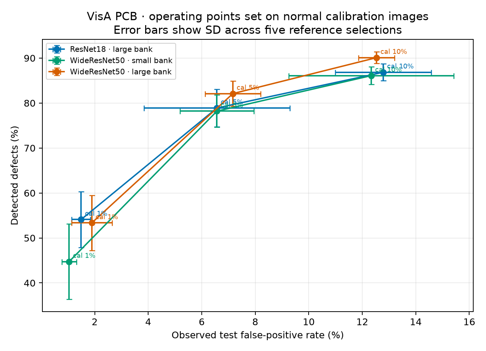
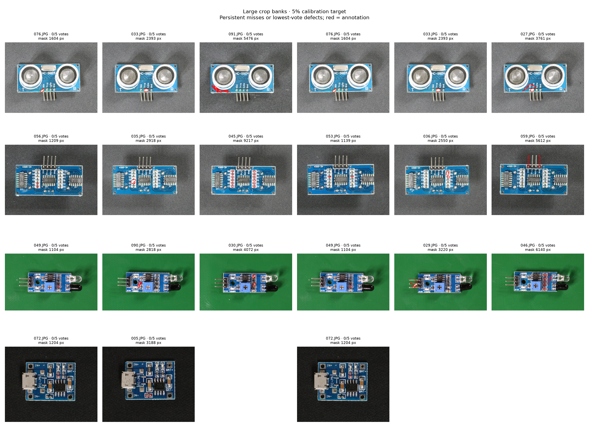

# Eşikler ve sürekli kaçırılan kusurlar

Bu analiz, [ortak ön işleme ve yama belleği deneyindeki](visa-controlled.tr.md) kayıtlı skorları kullanır. Test verisine bakıp yeni model ayarı seçmez. Her kategori ve referans seçimi için karar eşiğini, ayrılmış 100 normal kalibrasyon görüntüsünden yeniden hesaplar. Testte aynı daha önce incelenmiş 802 görüntü kullanılır; sonuçlar yeni ve bağımsız bir doğrulama değildir.

## Kalibrasyonda benzer alarm hedefi

Kalibrasyon eşiği normal görüntü skorlarının hedeflenen yüzdeliğiyle belirlenir. Beş referans seçiminin ortalaması ± örnek standart sapması:

| Ayar | Yama belleği | Testte yakalanan kusur | Testte yanlış alarm |
|---|---:|---:|---:|
| ResNet18, crop | 19,60 MiB | %78,90 ± 4,13 | %6,57 ± 2,73 |
| WideResNet50-2, crop | 1,96 MiB | %78,20 ± 3,59 | %6,57 ± 1,38 |
| WideResNet50-2, crop | 19,60 MiB | %82,10 ± 2,79 | %7,16 ± 1,03 |

Hedef kalibrasyonda %5'ti, gerçekleşen oran %4 oldu: 100 normal görüntü ve `higher` yüzdeliğiyle eşik tam kalibrasyon skorlarının üzerinde kalıyor ve alarm kuralı `skor > eşik`. Testteki yanlış alarm oranı garanti edilmediği için aynı kalibrasyon hedefi testte aynı alarm sayısı anlamına gelmiyor.

Küçük bankalı WRN ile büyük bankalı RN bu testte aynı ortalama yanlış alarm oranında benzer kusur yakaladı. Büyük bankalı WRN ise daha çok kusur yakalarken biraz daha fazla alarm verdi. Bu, yalnızca saklanan yama belleğini karşılaştırır; omurga ağırlıkları ve toplam çalışma belleği eşit değildir.



[Vektörel şekil](figures/visa-operating-points.pdf). Tam makine çıktısında sekiz ayarın her biri için üç eşik, beş seed ve tüm test örneklerinin oy sayıları bulunur: [JSON ve kaynak özetleri](../reports/visa-operating-points-v1.json).

Üç hedefin özeti:

| Kalibrasyon alarm hedefi | ResNet18 büyük bankada yakalama / test alarmı | WRN küçük bankada yakalama / test alarmı | WRN büyük bankada yakalama / test alarmı |
|---:|---:|---:|---:|
| %1 | %54,10 / %1,49 | %44,75 / %1,04 | %53,35 / %1,89 |
| %5 | %78,90 / %6,57 | %78,20 / %6,57 | %82,10 / %7,16 |
| %10 | %86,85 / %12,79 | %86,10 / %12,34 | %90,10 / %12,54 |

Kalibrasyonda 100 normal örnek bulunduğundan eşik yaklaşık yüzde birimlerinde ilerler; %1 hedefinde seçilen en yüksek eşik, gözlenen kalibrasyon alarmını sıfıra indiriyor. Bu oranlar yeni üretim görüntüleri için garanti değildir. Ek kalibrasyon ve fiziksel kart/oturum bazında ayrılmış test gerekir.

## Hangi kusurlar tekrar tekrar kaçıyor?

Bir kusura beş farklı referans seçiminin her birinde eşik altı skor verdiyse “kalıcı kaçırma” dedik. %5 kalibrasyon alarm hedefinde büyük bankalı modellerin her biri 400 kusurun 43'ünü kalıcı olarak kaçırdı. Kaçırılan kusurların 29'u ortaktı; RN'ye ve WRN'ye özgü 14'er kusur daha vardı. Bu beş karar birleştirilip yeni bir topluluk modeli oluşturulmadı.

| Büyük bankalı crop ayarı | Beş koşuda kaçan kusur | Beş koşuda alarm verilen normal |
|---|---:|---:|
| ResNet18 | 43/400 | 7/402 |
| WideResNet50-2 | 43/400 | 9/402 |

Kaçırmalar küçük maskeli kusurlarda daha sık. Dört PCB kategorisindeki 400 kusur maskesinin alanını birlikte sıraladığımızda, en küçük çeyrekte WRN'nin 23/100, orta yarıda 20/200 ve en büyük çeyrekte 0/100 kusuru beş koşunun tamamında kaçırdığı görüldü. Büyük maskeli kusurlar çoğunlukla yakalandı; ancak bu ilişki maskenin görsel önemini veya üretimdeki kusur zorluğunu tek başına açıklamaz.

PCB3 için WRN'nin kalıcı kaçırma sayısı 17/100; diğer kategoriler PCB1'de 11, PCB2'de 14 ve PCB4'te 1. Maske büyüklüğünü her kategori içinde ayrı çeyreklere böldüğümüzde PCB1, PCB2 ve PCB4'ün en büyük maske çeyreğinde kalıcı kaçırma yok; PCB3'te 1/25 var. Bu da küçük kusur alanının yanında kategori ve kusur biçiminin incelenmesi gerektiğini gösteriyor.

Kısmen kırpılan kusurlar ana neden gibi görünmüyor: WRN büyük bankada bu 35 kusurun 2'si, tamamen görünen 365 kusurun 41'i kalıcı olarak kaçtı. PCB3'taki 17 kalıcı kaçırmanın yalnızca biri kısmi kırpılan gruptaydı. Bu, kadraj etkisinin önemsiz olduğunu kanıtlamaz; yalnızca bu grupta kaçırmaların kırpılan kusurlarda yoğunlaşmadığını gösterir.



Her satır PCB1–PCB4'tür; soldaki üç örnek ResNet18, sağdaki üç örnek WideResNet50-2'dir. Görüntüler kalıcı kaçırmalar arasından anotasyon alanı küçükten büyüğe örneklenmiştir; kırmızı çizgiler veri kümesinin kusur maskeleridir. Bu şekil hata örneklerini gösterir, başarı ölçütü değildir.

## Araştırma için sonraki adım

Öncelik küçük kusurların yakalanmasını geliştirmek ve PCB3'teki hataları anlamak. Bunu seçilmiş test kümesinde ayar yaparak değil, daha çok normal kalibrasyon görüntüsü ve fiziksel kart/oturum bazında ayrılmış bağımsız verilerle sınamak gerekir. Özellikle düşük yanlış alarm hedeflerinde 100 kalibrasyon görüntüsü yetersiz hassasiyet sağlar.

Yerelde yeniden üretmek için önceki kontrollü deney çıktısı, VisA manifesti ve kusur maskeleri gerekir:

```console
python -m pcb_anomaly.operating_points --output data/visa-operating-points-v2
```

Bu komut model çalıştırmaz. Mevcut skorlarla sekiz ayarın üç kalibrasyon eşiğini hesaplar; beş seed'in sonuçlarını, kalıcı kaçırmaları, örnek görselleri ve girdi SHA256 özetlerini yazar. Her beş tekrar aynı test görüntülerini kullandığından bunlar beş bağımsız test değildir.
